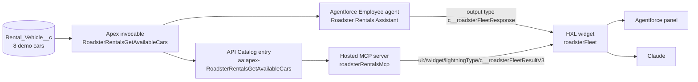

# Roadster Rentals: Build Once, Deploy Everywhere with HXL

One Salesforce **Headless Experience Layer (HXL)** widget, `roadsterFleet`, shows the available Roadster Rentals cars: a featured hero car plus a list of bookable cars. The **same widget bundle** renders in two places:

1. an **Agentforce Employee agent** in Lightning Experience, and
2. **Claude** (claude.ai, Claude Desktop, Claude Code), through a custom **Salesforce hosted MCP server**.

All car data comes from one Apex invocable action. Nothing is hardcoded in the widget.

> Roadster Rentals is a fictitious company. HXL and hosted MCP servers are **Beta** features.

## Watch the demo

[](https://youtu.be/m0YTqT9DuIU)

**YouTube:** https://youtu.be/m0YTqT9DuIU

## Contents

- [How it works](#how-it-works)
- [Option A: preview the widget in 2 minutes (no org)](#option-a-preview-the-widget-in-2-minutes-no-org)
- [Option B: deploy the full demo to your org](#option-b-deploy-the-full-demo-to-your-org)
- [Option C: rebuild it from scratch with Claude Code](#option-c-rebuild-it-from-scratch-with-claude-code)
- [Try it](#try-it)
- [Test](#test)
- [Change the image host](#change-the-image-host)
- [Troubleshooting](#troubleshooting)
- [Project layout](#project-layout)

## How it works



| Layer | Agentforce path | MCP / Claude path |
|---|---|---|
| Data | `Rental_Vehicle__c` (queried `WITH USER_MODE`) | same |
| Logic | Apex action `RoadsterRentalsGetAvailableCars` | same class, exposed through the API Catalog |
| Caller | Agent Script agent `Roadster_Rentals_Assistant`, subagent `car_rentals` | MCP tool `getAvailableRentalCars` (read-only) |
| Lightning type | `roadsterFleetResponse`: Apex-based schema + renderer | `roadsterFleetResultV3`: wraps the MCP `outputValues` envelope (`roadsterFleetOutputValues`) + renderer |
| UI | `uiWidgets/roadsterFleet` | the same `uiWidgets/roadsterFleet` |
| Auth | Lightning session | External Client App `Roadster_Rentals_MCP` (OAuth, PKCE, JWT tokens) |

The widget has a header, a hero card for the featured car, an empty-state callout, and a card for each car. Each card shows the photo, category, seats, transmission, fuel, range, rating and daily price. The **Book** button sends a chat message such as `Book the Toyota RAV4 at Hyderabad Airport`. The agent confirms the car and price, says that nothing has been booked yet, and asks for a pickup date. No booking record is created.

## Option A: preview the widget in 2 minutes (no org)

1. Open the [HXL Playground](https://www.headlessexperiencelayer.com/playground/), click **Open Editor**, then **New widget** > **Blank widget**.
2. **Structure** tab: replace everything with the contents of [playground/roadsterFleet.structure.json](playground/roadsterFleet.structure.json).
3. **Data** tab: keep `$meta` and `$i18n`, and add the `$attrs` object from one of these files:
   - [sample-data.hyderabad.json](playground/sample-data.hyderabad.json): featured Tesla Roadster + 3 cars
   - [sample-data.all-locations.json](playground/sample-data.all-locations.json): every available car
   - [sample-data.bengaluru.json](playground/sample-data.bengaluru.json): 2 cars, no featured card
   - [sample-data.empty.json](playground/sample-data.empty.json): the empty-state callout
4. Click any **Book** button. The Playground shows `Sent: Book the ...`.

Car photos do not load in the Playground because its Content Security Policy blocks `raw.githubusercontent.com`. This is a Playground limit, not a widget bug. The photos load in Agentforce and in Claude.

## Option B: deploy the full demo to your org

### Prerequisites

| Requirement | Notes |
|---|---|
| Salesforce org | A Developer Edition org on **Winter '27** or later, with **Agentforce** turned on |
| HXL (Beta) | Setup > Quick Find `headless` > **Headless Experience Layer Settings** > review the beta terms and turn on **Headless Experience Layer (Beta)** |
| Hosted MCP servers (Beta) | Setup > Quick Find **MCP Servers** (under API Catalog) must be available in your org |
| Salesforce CLI | **2.154.4 or later** (`sf --version`, then `sf update stable` if needed). Version 2.136.8 cannot deploy `UiWidgetBundle` (*"Could not infer a metadata type"*) |
| Node.js | 18 or later (only for the image helper script) |
| Claude | A claude.ai account that can add custom connectors (for the MCP part) |

`sourceApiVersion` is **67.0**, the minimum for `UiWidgetBundle`. Do not deploy or retrieve at a lower API version. At 65.0 the MCP `<resources>` element is silently dropped.

### 1. Clone and log in

```bash
git clone https://github.com/batra-kapil/Headless-Experience-Layer-HXL.git
cd Headless-Experience-Layer-HXL
sf org login web --alias HXL
```

Every command below uses the alias `HXL`. If you use another alias, change `--target-org` in the commands.

### 2. Deploy, in this order

Run the commands from the project root and stop at the first failure. The order matters:

- The Lightning types reference the widget.
- The agent references the Apex action and the Lightning type.
- The permission set grants access to the agent, so the agent must exist before the permission set is deployed.
- The Apex tests assign the permission set.

```bash
# 1. Custom object and its 14 fields
sf project deploy start --source-dir force-app/main/default/objects --target-org HXL

# 2. Apex (tests run in step 8, after the permission set exists)
sf project deploy start --source-dir force-app/main/default/classes --target-org HXL --test-level NoTestRun

# 3. HXL widget (must exist before the Lightning types that reference it)
sf project deploy start --source-dir force-app/main/default/uiWidgets --target-org HXL

# 4. Lightning types (Agentforce + MCP)
sf project deploy start --source-dir force-app/main/default/lightningTypes --target-org HXL

# 5. Trusted URL so car images load (img-src only)
sf project deploy start --source-dir force-app/main/default/cspTrustedSites --target-org HXL

# 6. Agentforce Employee agent: deploy, publish, activate
sf project deploy start --source-dir force-app/main/default/aiAuthoringBundles --target-org HXL
sf agent publish authoring-bundle --api-name Roadster_Rentals_Assistant --target-org HXL
sf agent activate --api-name Roadster_Rentals_Assistant --version 1 --target-org HXL

# 7. Permission set (object and field read access + agent access), then assign it to yourself
sf project deploy start --source-dir force-app/main/default/permissionsets --target-org HXL
sf org assign permset --name Roadster_Rentals_Access --target-org HXL

# 8. Run the Apex tests
sf apex run test --class-names RoadsterRentalsGetAvailableCarsTest --code-coverage --result-format human --wait 10 --target-org HXL
```

Notes:

- Do not use the Lightning Types page in Setup to create or edit these Lightning types. Deploy them from the files.
- `sf agent publish` writes `aiAgents/` and `aiAgentDefinitionVersions/` into your project. These folders contain IDs from your org, so they are git-ignored. Do not deploy them by hand.
- Anyone who uses the agent or connects Claude needs the `Roadster_Rentals_Access` permission set, because the action queries `WITH USER_MODE`.

### 3. Import the demo data

```bash
sf data import tree --files data/Rental_Vehicle__c.json --target-org HXL
```

This creates 8 cars at Hyderabad Airport, Bengaluru Airport and San Francisco Airport. The Maruti Suzuki Swift is marked unavailable, so it never appears. Running the import twice creates duplicates, so delete the old records before you import again. The images are served from the public repo [batra-kapil/roadster-rentals-assets](https://github.com/batra-kapil/roadster-rentals-assets), so they work without changes.

At this point the **Agentforce** half works. See [Try it](#try-it).

### 4. Deploy the hosted MCP server

```bash
sf project deploy start --source-dir force-app/main/default/mcpServerDefinitions --target-org HXL
```

This creates the server `roadsterRentalsMcp` with:

- tool `getAvailableRentalCars` (read-only), backed by the API Catalog entry that Salesforce creates from the global Apex class
- UI resource `roadsterFleetV3` = `ui://widget/lightningType/c__roadsterFleetResultV3`

### 5. Deploy the External Client App (OAuth for Claude)

First replace the `[EMAIL]` placeholder in `<contactEmail>` in [force-app/main/default/externalClientApps/Roadster_Rentals_MCP.eca-meta.xml](force-app/main/default/externalClientApps/Roadster_Rentals_MCP.eca-meta.xml) with your own email address before you deploy.

```bash
# The global OAuth settings folder is git-ignored (see the note below). Copy in the clean template first.
cp -R config/eca-template/extlClntAppGlobalOauthSets force-app/main/default/

sf project deploy start --target-org HXL \
  --source-dir force-app/main/default/externalClientApps \
  --source-dir force-app/main/default/extlClntAppOauthSettings \
  --source-dir force-app/main/default/extlClntAppGlobalOauthSets \
  --source-dir force-app/main/default/extlClntAppOauthPolicies
```

What gets configured:

- scopes `MCP, RefreshToken`
- callback `https://claude.ai/api/mcp/auth_callback`
- PKCE required, JWT-based access tokens, consumer secret optional
- all users self-authorized, refresh token valid until revoked

A new External Client App can take **up to 30 minutes** to start working.

> **Security note:** retrieving `ExtlClntAppGlobalOauthSettings` from an org writes the **consumer key** into the file. That is why `**/extlClntAppGlobalOauthSets/` is in `.gitignore`. Never retrieve this type into a folder you commit, and never paste the key into a project file.

### 6. Activate the MCP server (Setup)

1. Setup > Quick Find **MCP Servers** (under API Catalog) > turn **roadsterRentalsMcp** on. It can take up to 2 minutes to take effect.
2. Note the server URL that Setup shows. For a Developer Edition or production org it follows this pattern:

```text
https://api.salesforce.com/platform/mcp/v1/custom/roadsterRentalsMcp
```

Docs: [Activate MCP servers](https://developer.salesforce.com/docs/platform/hosted-mcp-servers/guide/activate-mcp-servers.html)

### 7. Get the consumer key (Setup)

Setup > Quick Find `external client` > **External Client App Manager** > **Roadster Rentals MCP** > **Settings** > under **OAuth Settings** click **Consumer Key and Secret**. Salesforce may ask you to verify your identity. Copy the key straight into Claude in the next step.

Docs: [Create an External Client App](https://developer.salesforce.com/docs/platform/hosted-mcp-servers/guide/create-external-client-app.html)

### 8. Connect Claude

These steps apply to claude.ai and Claude Desktop. Claude Code inherits the same connection.

1. Left sidebar > **Customize** > **Connectors** > **Add** > **Add custom connector**.
2. **Name:** anything, for example `Roadster Rentals`.
3. **Server URL:** the URL from step 6.
4. Click **Continue**. Under OAuth client, choose **Use your own OAuth client**.
5. **OAuth Client ID:** the consumer key. Leave **OAuth Client Secret** blank.
6. Click **Connect** and log in to your org as a user who has `Roadster_Rentals_Access`.

Docs: [Connect Claude to a hosted MCP server](https://developer.salesforce.com/docs/platform/hosted-mcp-servers/guide/claude.html)

## Option C: rebuild it from scratch with Claude Code

[prompt/hxl-roadster-rentals-claude-code-prompt.md](prompt/hxl-roadster-rentals-claude-code-prompt.md) is a single prompt that rebuilds the whole demo in an empty folder with Claude Code and the [Salesforce Skills](https://github.com/forcedotcom/sf-skills). It includes every lesson learned from the original build. Claude Code asks before every deploy and tells you when a step needs you in Setup or in Claude.

The skills used for this build are in [.claude/skills/](.claude/skills/), copied from `forcedotcom/sf-skills` and pinned in [skills-lock.json](skills-lock.json).

## Try it

### In Agentforce

Open Lightning Experience > **Agentforce** panel > pick **Roadster Rentals Assistant**, or use Agentforce Builder Live Test on the active version. Start a fresh conversation:

```text
I want to book a car at Hyderabad Airport
```

**Expected:** a short text answer plus the widget.

- Header **Roadster Rentals**, *4 cars available at Hyderabad Airport*.
- The **Tesla Roadster** featured card: large photo, Featured badge, tagline, $1,999 / day, Book.
- Then a list: Mahindra XUV700 ($55), Toyota RAV4 ($65), Tesla Model 3 ($89).

Click **Book** on a card. It sends `Book the Toyota RAV4 at Hyderabad Airport`, and the agent replies that nothing has been booked yet and asks for a pickup date.

### In Claude

Start a new chat with your connector turned on and send the same prompt. You get the same widget, with the Roadster first.

### More prompts

| Prompt | Result |
|---|---|
| `show me available cars in Hyderabad` | Same 4 cars (a city name matches its airport) |
| `cars at Bengaluru Airport` | 2 cars, no featured card |
| `any SUVs under 60 a day?` | Mahindra XUV700 only |
| `economy cars` | Empty-state callout (the only Economy car, the Swift, is unavailable) |

The model decides whether to show the card. If you only get text, clear the history (Agentforce) or start a new chat (Claude), then ask again.

## Test

```bash
# Apex tests with coverage (13 tests, 96% coverage on the action)
sf apex run test --class-names RoadsterRentalsGetAvailableCarsTest --code-coverage --result-format human --wait 10 --target-org HXL

# Call the action from anonymous Apex (expect 7 cars with no filter, 2 at Bengaluru Airport)
sf apex run --file scripts/apex/t3-get-available-cars.apex --target-org HXL

# Call the action through the Actions REST API (the same envelope the MCP tool returns)
sf api request rest '/services/data/v67.0/actions/custom/apex/RoadsterRentalsGetAvailableCars' \
  --method POST --body '{"inputs":[{"location":"Hyderabad Airport"}]}' --target-org HXL
```

## Change the image host

The helper script reads this line (keep it on one line):

IMAGE_BASE_URL=https://raw.githubusercontent.com/batra-kapil/roadster-rentals-assets/main/cars

1. Put your own images somewhere public. The file names are listed in [assets/cars/README.md](assets/cars/README.md), and copies are in [assets/cars/](assets/cars/).
2. Edit the `IMAGE_BASE_URL=` line above. A trailing slash is not needed.
3. Run `node scripts/apply-image-base-url.js`. This rewrites `data/Rental_Vehicle__c.json` and generates `scripts/apex/update-image-urls.apex`.
4. If the records are already in the org, run `sf apex run --file scripts/apex/update-image-urls.apex --target-org HXL`.
5. If the host is not `raw.githubusercontent.com`, change `endpointUrl` in [Roadster_Rentals_Car_Images.cspTrustedSite-meta.xml](force-app/main/default/cspTrustedSites/Roadster_Rentals_Car_Images.cspTrustedSite-meta.xml) and redeploy it. Salesforce builds the MCP widget's CSP from Trusted URLs.

## Troubleshooting

| Symptom | Fix |
|---|---|
| `Could not infer a metadata type` on `roadsterFleet.uiwidget-meta.xml` | Salesforce CLI is too old. Run `sf update stable` (2.154.4+) |
| Permission set deploy fails on `agentAccesses` / unknown agent | Publish the agent first (deploy step 6), then deploy the permission set |
| `List has no rows for assignment to SObject` in the Apex tests | The `Roadster_Rentals_Access` permission set is not in the org yet. Deploy it, then rerun the tests |
| The action returns no cars for your user | Assign `Roadster_Rentals_Access` (the query runs `WITH USER_MODE`) |
| Car photos are broken in Agentforce or Claude | Check that the Trusted URL `Roadster_Rentals_Car_Images` is active for `img-src` and that the image URLs return 200 |
| Car photos are broken in the HXL Playground | Expected. The Playground's own CSP blocks the image host |
| Claude cannot connect right after setup | Wait up to 30 minutes for the new External Client App, and check that the MCP server is active in Setup |
| Claude shows an old version of the widget after you redeploy | Start a new chat. If it is still stale, remove the connector and add it again. As a last resort, use a new versioned resource URI (that is why the type is called `...ResultV3`) |
| Featured card is empty on the MCP path | Bind the hero through a list (`forEach` over `featuredCars`), not an object attribute path. This repo already does that |
| `sf agent preview start --authoring-bundle ...` crashes with `reading 'replace'` | Known CLI bug for Employee agents. Preview the published agent with `--api-name`, or use Agentforce Builder |
| Widget shows text only | The model chose not to render the card. Start a fresh conversation and ask again |

The full evidence log for every deploy, test and workaround is in [VERIFIED_FACTS.md](VERIFIED_FACTS.md) (see its **Gotchas** table). The original build handoff and shot list are in [HANDOFF.md](HANDOFF.md).

Placeholders such as `[YOUR_ORG_ID]`, `[YOUR_USERNAME]`, `[EMAIL]`, `[DEPLOY_ID]`, `[SESSION_ID]` and `[TRACE_ID]` in `VERIFIED_FACTS.md` and `HANDOFF.md` stand in for values from the original build org. They are not needed to deploy.

## Project layout

| Path | What it is |
|---|---|
| `force-app/main/default/objects/Rental_Vehicle__c/` | Custom object and 14 fields |
| `force-app/main/default/classes/RoadsterRentalsGetAvailableCars.cls` | Global invocable action "Get Available Rental Cars" (filters: location, category, max daily rate) |
| `force-app/main/default/classes/RoadsterRentalsGetAvailableCarsTest.cls`, `TestDataFactory.cls` | Apex tests |
| `force-app/main/default/uiWidgets/roadsterFleet/` | The HXL widget: composition, schema, metadata |
| `force-app/main/default/lightningTypes/roadsterFleetResponse/` | Agentforce path: Apex-based Lightning type + renderer |
| `force-app/main/default/lightningTypes/roadsterFleetOutputValues/` | MCP payload Lightning type (no renderer) |
| `force-app/main/default/lightningTypes/roadsterFleetResultV3/` | MCP result wrapper Lightning type + renderer (the MCP `resourceUri`) |
| `force-app/main/default/aiAuthoringBundles/Roadster_Rentals_Assistant/` | Agent Script Employee agent with the `car_rentals` subagent |
| `force-app/main/default/mcpServerDefinitions/` | Hosted MCP server `roadsterRentalsMcp` (tool + UI resource) |
| `force-app/main/default/externalClientApps/`, `extlClntApp*` | External Client App `Roadster_Rentals_MCP` for Claude OAuth |
| `config/eca-template/extlClntAppGlobalOauthSets/` | Clean global OAuth settings (no consumer key) to copy in before deploy |
| `force-app/main/default/permissionsets/Roadster_Rentals_Access.permissionset-meta.xml` | Read on the object and all fields + agent access |
| `force-app/main/default/cspTrustedSites/` | Trusted URL for the image host |
| `data/Rental_Vehicle__c.json` | 8 demo cars for `sf data import tree` |
| `playground/` | Widget structure and sample data for the HXL Playground |
| `scripts/apply-image-base-url.js` | Repoints all image URLs to a new host |
| `scripts/apex/` | Anonymous Apex smoke test and the generated image-URL update script |
| `assets/cars/` | The 8 car photos |
| `prompt/` | The rebuild-it-yourself Claude Code prompt |
| `.claude/skills/` | Salesforce Skills used to build this (from `forcedotcom/sf-skills`) |
| `VERIFIED_FACTS.md`, `HANDOFF.md` | Build evidence log and handoff notes |

## Useful links

- Demo video: https://youtu.be/m0YTqT9DuIU
- HXL Playground: https://www.headlessexperiencelayer.com/playground/
- Salesforce hosted MCP servers: https://developer.salesforce.com/docs/platform/hosted-mcp-servers/guide/custom-servers.html
- Expose custom Apex as a hosted MCP tool: https://developer.salesforce.com/blogs/2026/05/expose-custom-apex-as-a-hosted-mcp-tool-for-agents
- Salesforce Skills: https://github.com/forcedotcom/sf-skills

## Questions

Questions or ideas? Open an issue.
